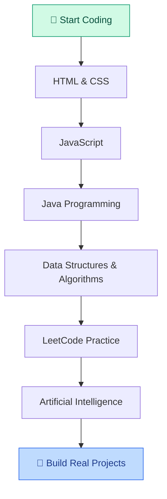

<!-- ================= HEADER ================= -->

# 👋 Hi, I'm Abhinav Singh

### 💻 BTech CSE | Artificial Intelligence Enthusiast

 

---

<!-- ================= ABOUT ME ================= -->

## 🙋‍♂️ About Me

- 🎓 First-year BTech CSE student specializing in AI.
- 💻 Currently learning Java and JavaScript.
- 🌐 Exploring HTML, CSS and Web Development.
- 🧠 Practicing problem-solving and Data Structures.
- 🤖 Interested in Artificial Intelligence.
- 🎯 My goal is to become an AI Engineer.
- 🚀 Learning something new every day!

 

---

<!-- ================= TECH STACK ================= -->

## 🛠️ Languages and Tools

---

<!-- ================= LEARNING ROADMAP ================= -->

## 📚 My Learning Roadmap

---

<!-- ================= CURRENT FOCUS ================= -->

## 🎯 What I'm Working On

| Technology | Current Goal |
|---|---|
| ☕ Java | Improve programming logic |
| 🌐 HTML & CSS | Build responsive websites |
| ⚡ JavaScript | Learn interactive web development |
| 🧩 LeetCode | Improve problem-solving skills |
| 🤖 AI | Learn the fundamentals |

---

://github-readme-stats.vercel.app/api/top-langs/?username=YOUR_USERNAME&layout=compact&theme=tokyonight&hide_border=true" alt="Most used languages" />

---

<!-- ================= CONNECT ================= -->

## 🤝 Connect With Me

---

### 💡 "Learn, Build, Improve, Repeat."

⭐ Thanks for visiting my profile!

